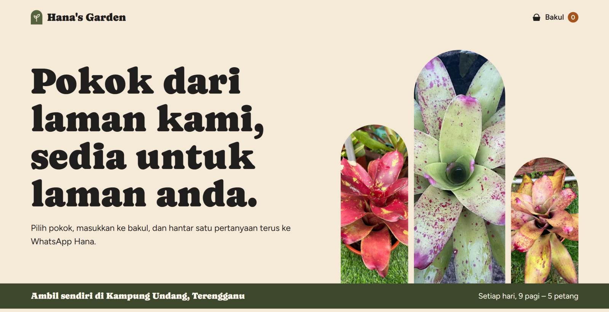

# Hana's Garden

Potted plants from my family's home garden in Kampung Undang, Terengganu. Have a look at what's growing, pick a few, and reserve them with one WhatsApp message. Then come by and collect them.

**[Visit the shop](https://lamanhana.netlify.app)**

## Untuk pelanggan

Hana's Garden ialah laman pokok keluarga kami di Kampung Undang. Lihat pokok yang ada, masukkan ke bakul, dan hantar satu pertanyaan terus ke WhatsApp Hana. Hana akan sahkan stok dan harga, kemudian anda datang ambil sendiri.

- **Ambil sendiri:** Kampung Undang, Terengganu
- **Waktu:** setiap hari, 9 pagi hingga 5 petang
- Untuk jiran sekampung, kawan-kawan dan sesiapa sahaja di sekitar Terengganu yang boleh singgah

## About the garden

Hana's Garden is my mom's garden. She grows plants at home, like the bromeliads in the photos above, and sells them to neighbours, friends and family around Terengganu. Pickup only, so there's no delivery or shipping.

I built this site for her so people can see what she has before they ask, and she can keep track of every request in one place.

## How ordering works

1. **Browse:** every plant has a photo, an estimated price, and whether it's in stock.
2. **Fill a basket:** pick as many plants as you like and set how many of each.
3. **Choose a pickup time:** any of the next 7 days, morning or afternoon.
4. **Send on WhatsApp:** WhatsApp opens with your list already written. Press send, and Hana replies to confirm stock and the final price.
5. **Collect:** pick the plants up in Kampung Undang.

There's no app to install, no account to make, and no online payment. All you need is WhatsApp.

## What it makes easier

**For customers**

- You can see what's available without messaging first to ask "ada lagi tak?"
- Prices are shown up front. They're estimates, and Hana confirms the final price.
- One message carries the whole list, instead of sending photos back and forth.

**For my mom**

- Every request is saved to a Google Sheet, so none get lost in a busy WhatsApp chat.
- From her phone, she can mark a plant sold out, change a price, or add a new plant with a photo, behind a 6-digit passcode.
- It costs nothing to run, because it uses the free plans of Netlify and Google.

## Under the hood

A React and TypeScript site built with Vite and hosted on Netlify. Google Sheets holds the plants and requests, Google Drive holds new photos, and a small Google Apps Script connects them, so there's no server to pay for or look after.

The admin passcode, WhatsApp number and customer details are never stored in this repository. Tests, including attacks an outsider might try, run on every push.

To run it yourself or connect your own Google Sheet, see **[docs/SETUP.md](docs/SETUP.md)**.
